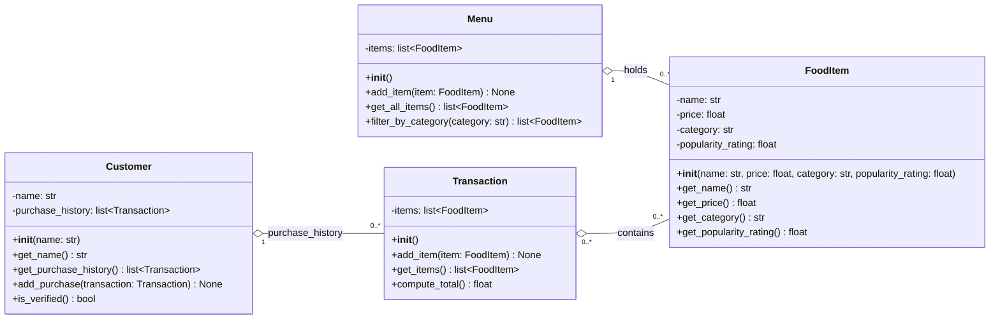

# ByteBites — UML Class Diagram

Derived from [bytebites_spec.md](bytebites_spec.md), scoped per [ByteBites_Design_Reference.md](ByteBites_Design_Reference.md) (no auth, no database, no features beyond the spec). Candidate classes map as follows:

| Candidate     | Class name    | Responsibility                                              |
|---------------|---------------|-------------------------------------------------------------|
| customer      | `Customer`    | Tracks a user's name and purchase history; verifies users   |
| items         | `FoodItem`    | A single sellable item: name, price, category, popularity   |
| collection    | `Menu`        | Holds all food items; filters by category                   |
| transaction   | `Transaction` | Groups selected items into one purchase; computes the total |

Visibility key: `+` public, `-` private, `#` protected. Names use Python `snake_case`; types use Python type hints.

## Relationships

| From          | To            | Type            | Multiplicity  | Meaning                                                                       |
|---------------|---------------|-----------------|---------------|-------------------------------------------------------------------------------|
| `Customer`    | `Transaction` | Aggregation (◇) | 1 → 0..*      | A customer's purchase history is a list of their past transactions            |
| `Menu`        | `FoodItem`    | Aggregation (◇) | 1 → 0..*      | The menu holds every item for sale and can filter them by category            |
| `Transaction` | `FoodItem`    | Aggregation (◇) | 0..* → 0..*   | A transaction groups selected items; one item can appear in many transactions |

## Design notes

- **Aggregation, not composition**, everywhere: a `FoodItem` exists on the menu and in any number of transactions, and deleting a transaction must not delete the item (or the customer's other history).
- **`Customer.is_verified()`** covers "verify they are real users": returns `True` when `purchase_history` is non-empty.
- **`Transaction.compute_total()`** sums `get_price()` across `items`, so the total is always calculated and never stored, which means it can't go out of date.
- **`Menu.filter_by_category()`** returns a new list (e.g. `"Drinks"`, `"Desserts"`) and leaves the full collection unchanged.
- **`Transaction` items start empty** (`__init__()` takes no items), which is why its multiplicity to `FoodItem` is `0..*` rather than `1..*`.
